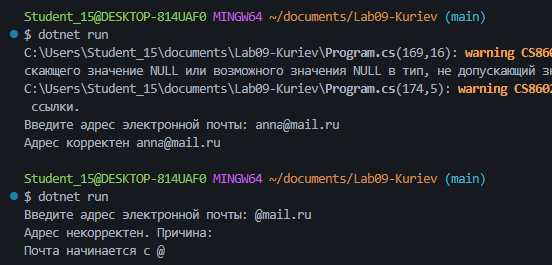
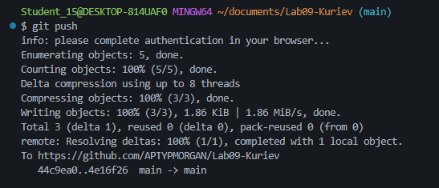

# Практическая работа №9
**ФИО: Куриев Артур Майрбекович**
**Группа: ИСП-241**
**Дата: 22.10.2026**
## Что изучено
* Как работать с длиной строк и их индексами
* Как проверять содержимое строки с помощью Contains, StartsWith, EndsWith
* Как изменить содержимое строк с помощью ToUpper, ToLower и Replace
* Как вырезать конкретную часть строки с помощью Substring

